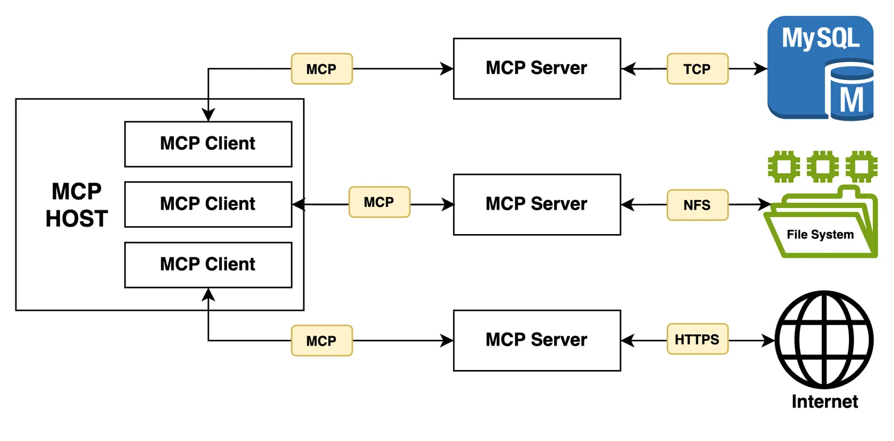

# [使用 Quarkus 和 LangChain4j 实现 Model Context Protocol](https://www.baeldung.com/langchain4j-quarkus-mcp)

最后更新：2025 年 7 月 23 日

标签：人工智能 · LangChain · MCP · Quarkus

1. 概述

    随着大语言模型（LLM）的出现，各团队正越来越多地把 AI 集成到自己的应用中。AI 集成已不再局限于简单的问答。Model Context Protocol（模型上下文协议）正是有助于此类集成的一种理念。

    在本教程中，我们将探讨如何使用 Quarkus 和 LangChain4j 构建 Model Context Protocol 的服务器与客户端。我们会创建一个简单的聊天机器人，并通过 MCP 服务器扩展 LLM 的能力，让它完成一些简单的自定义任务，例如根据时区获取当前日期，以及获取服务器 JVM 的相关信息。

2. Model Context Protocol 入门

    Anthropic 于 2024 年 11 月将其 Model Context Protocol（[MCP](https://www.anthropic.com/news/model-context-protocol)）开源。MCP 提供了一种标准化的方式，把 AI 驱动的应用与外部数据源连接起来。在动手写代码之前，我们先来理解一下为什么需要 MCP，以及它究竟是什么。

    1. 为什么需要 Model Context Protocol？

        随着 AI 应用日益普及，人们越来越期望通过 LLM 来暴露组织内部和应用特有的“上下文”。因此，如何把这些上下文集成进 AI 工作流，也需要认真考量。

        上下文可以来自多种不同的数据源，例如数据库、文件系统、搜索引擎以及其他工具。由于数据源种类繁多、底层连接方式各异，把这些上下文引入 AI 集成就成了一项不小的挑战。

        这类集成当然可以直接写进 AI 应用本身，但那很可能会增加应用的复杂度。此外，许多组织已经拥有大量现有的内部应用服务，提供着各种各样的信息。我们理想中需要的，是一种能够把现有服务与 AI 集成起来、又不产生紧耦合的方案。

    ### 2.2. Model Context Protocol 简介

    现在我们理解了：需要某种协议来帮助汇集来自各种数据源的上下文。Model Context Protocol 正是为满足这一需求而生。借助 MCP，我们可以在原生 LLM 之上构建复杂的智能体（agent）和工作流，而无需把它们紧密耦合在一起。

    这类似于用户界面通过 REST API 与后端通信：一旦 API 契约确立，只要契约不变，UI 和后端就可以各自独立演进。

    我们注意到，尽管 LLM 在训练时使用了海量数据、记忆中固化了大量信息，但它们并不了解实时信息或专有信息。探索 MCP 的一个简单方式，就是尝试一些能让 LLM 查询此类信息的简单服务。

    在深入代码之前，我们先快速看一下 [MCP 的架构及其组件](https://www.baeldung.com/spring-ai-model-context-protocol-mcp)：

    

    MCP 采用客户端—服务器架构，包含几个关键组件：

    - **MCP Host（宿主）**：我们的主应用，它与 LLM 集成，并需要连接外部数据源。
    - **MCP Client（客户端）**：与 MCP 服务器建立并维护一对一（1:1）连接的组件。
    - **MCP Server（服务器）**：与外部数据源集成，并对外暴露交互功能的组件。

    为了处理客户端与服务器之间的通信，MCP 还提供了两种传输通道：

    - **标准输入/输出（stdio）** 传输类型：用于通过标准输入输出流与本地进程和命令行工具通信。
    - **服务器发送事件（SSE）** 传输类型：用于客户端与服务器之间基于 HTTP 的通信。

    MCP 是一个复杂而庞大的主题，更多细节可以参阅[官方文档](https://modelcontextprotocol.io/)。

3. 创建自定义 MCP 服务器

    现成的 [MCP 服务器](https://github.com/modelcontextprotocol/servers)有不少，只需少量安装与配置即可使用。不过在本文中，我们会介绍如何用 Quarkus 创建自己的 [MCP 服务器](https://quarkus.io/blog/mcp-server/)。

    为此，我们将用 Quarkus 构建两个简单的功能性 Tool（工具）：一个根据时区获取当前日期，另一个提供服务器 JVM 的信息。

    1. 创建 Quarkus MCP 服务器项目

        前置条件是安装好 JDK 和 Quarkus CLI。准备好之后，即可创建新项目：

        ```bash
        quarkus create app --no-code -x qute,quarkus-mcp-server-sse quarkus-mcp-server
        ```

        这会在名为 `quarkus-mcp-server` 的目录下创建一个具备 Quarkus 项目基础脚手架的新项目。

    2. 依赖

        使用 Quarkus CLI 创建的项目会自动加入核心依赖（`quarkus-arc` 和 `quarkus-junit5`），以及我们在命令中指定的扩展所对应的依赖。在本例中，这些扩展是 `qute` 和 `quarkus-mcp-server-sse`：

        ```xml
        <dependencies>
            <dependency>
                <groupId>io.quarkus</groupId>
                <artifactId>quarkus-arc</artifactId>
            </dependency>
            <dependency>
                <groupId>io.quarkus</groupId>
                <artifactId>quarkus-junit5</artifactId>
                <scope>test</scope>
            </dependency>
            <dependency>
                <groupId>io.quarkiverse.mcp</groupId>
                <artifactId>quarkus-mcp-server-sse</artifactId>
                <version>1.1.1</version>
            </dependency>
            <dependency>
                <groupId>io.quarkus</groupId>
                <artifactId>quarkus-qute</artifactId>
            </dependency>
        </dependencies>
        ```

        接下来我们就可以创建供 LLM 后续使用的 Tool 了。

    3. 定义并暴露自定义工具

        我们来添加几个工具。在没有工具的情况下，大多数 LLM 无法获取实时信息。因此，如果我们问 LLM 当前日期和时间，它很可能会回答训练数据冻结时的日期和时间。

        所以，为了验证通过 MCP 服务器增强 LLM 能力的效果，我们先创建一个简单的工具，用于提供用户（或函数调用方）所在时区的当前日期和时间：

        ```java
        @Tool(description = "Get the current time in a specific timezone.")
        public String getTimeInTimezone(
        @ToolArg(description = "Timezone ID (e.g., America/Los_Angeles)") String timezoneId) {
            try {
                ZoneId zoneId = ZoneId.of(timezoneId);
                ZonedDateTime zonedDateTime = ZonedDateTime.now(zoneId);
                DateTimeFormatter formatter = DateTimeFormatter.ofLocalizedDateTime(java.time.format.FormatStyle.FULL)
                .withLocale(Locale.getDefault());
                return zonedDateTime.format(formatter);
            } catch (Exception e) {
                return "Invalid timezone ID: " + timezoneId + ". Please provide a valid IANA timezone ID.";
            }
        }
        ```

        我们把这个功能性工具封装在一个名为 `ToolBox` 的普通 Java 类中。来自 Quarkus 的 `@Tool`（`io.quarkiverse.mcp.server.Tool`）注解告诉 Quarkus 框架：被注解的方法要作为 MCP 服务器中的一个工具对外暴露。

        同样，`@ToolArg`（`io.quarkiverse.mcp.server.ToolArg`）注解告诉 Quarkus 框架：被注解的方法参数应当连同所提供的描述一起暴露出去。

        这里需要重点强调：`description` 字段应当清晰地说明调用方正确使用该函数所需的信息。描述能帮助 LLM 识别工具的用途，从而在回答终端用户的问题时判断该考虑使用哪个工具。

        我们再添加一个函数，用于获取 MCP 服务器所运行 JVM 的信息：

        ```java
        @Tool(description = "Provides JVM system information such as available processors, free memory, total memory, and max memory.")
        public String getJVMInfo() {
            StringBuilder systemInfo = new StringBuilder();

            // Get available processors
            int availableProcessors = Runtime.getRuntime().availableProcessors();
            systemInfo.append("Available processors (cores): ").append(availableProcessors).append("\n");

            // Get free memory
            long freeMemory = Runtime.getRuntime().freeMemory();
            systemInfo.append("Free memory (bytes): ").append(freeMemory).append("\n");

            // Get total memory
            long totalMemory = Runtime.getRuntime().totalMemory();
            systemInfo.append("Total memory (bytes): ").append(totalMemory).append("\n");

            // Get max memory
            long maxMemory = Runtime.getRuntime().maxMemory();
            systemInfo.append("Max memory (bytes): ").append(maxMemory).append("\n");
            return systemInfo.toString();
        }
        ```

    4. 运行 MCP 服务器

        有了这两个工具，我们就可以用 dev 模式运行 Quarkus 服务器，快速进行测试。

        为了简化部署和开发，我们把服务器打包成 uber-jar。这样就可以执行 `mvn install`，并把 JAR 发布到 Maven 仓库，方便我们自己以及他人共享和运行。

        Quarkus 默认使用 HTTP 端口 8080。我们把它改成 9000，因为后面 MCP 客户端那一侧需要用到 8080 端口。这两处改动都写在 `application.properties` 文件里：

        ```properties
        quarkus.package.jar.type=uber-jar
        quarkus.http.port=9000
        ```

        现在可以用 Quarkus CLI 启动 dev 模式。dev 模式服务器启动完成后，应该可以通过 <http://localhost:9000/q/dev-ui/> 访问：

        ```bash
        quarkus dev
        ```

        由于我们用 `@Tool` 注解把函数暴露为 MCP 服务器的一部分，dev 模式会自动为我们加上一个 MCP server 扩展。借助它提供的那种类似 Open API / Postman 的工具调用界面，我们可以快速测试这些工具。

    5. 测试工具

        接下来我们用 Quarkus Dev UI 中的 MCP server 扩展做一些快速测试。

        首先进入 Dev UI 的 tools 标签页：点击 MCP server 扩展下的 **Tools** 链接即可。

        也可以直接访问 URL：<http://localhost:9000/q/dev-ui/io.quarkiverse.mcp.quarkus-mcp-server-sse/tools> 。可以看到，我们定义的两个工具都列在那里，可以通过 **Call** 操作按钮进行快速测试：

        > Quarkus 函数调用测试器（quarkus Call Function Tester）。

        我们给 `getTimeInTimezone` 工具传入一个具体的时区来调用它。调用界面已经根据我们的描述预填了一份 JSON，我们把它改成真实的取值：

        ```json
        {
            "timezoneId": "Asia/Kolkata"
        }
        ```

        填好输入后点击 **Call** 按钮，响应区域会立即以 JSON 格式给出相应的输出：

        ```json
        {
            "jsonrpc": "2.0",
            "id": 3,
            "result": {
                "isError": false,
                "content": [
                    {
                        "text": "Sunday, May 18, 2025, 7:33:26 PM India Standard Time",
                        "type": "text"
                    }
                ]
            }
        }
        ```

        同样地，我们也可以测试另一个函数。服务器侧就绪之后，我们转到客户端一侧。

4. 创建自定义 MCP 客户端

    我们已经有了一个带两个自定义工具的 MCP 服务器，现在要把这些工具开放给我们与 LLM 的对话。为此，我们会使用 Quarkus 和 LangChain4j。至于 LLM API，我们使用运行在本机的 Ollama，模型选用 Mistral。当然，也可以换成 LangChain4j 支持的任何其他 LLM。

    1. 创建 Quarkus MCP 客户端项目

        同样可以用 Quarkus CLI 创建新项目：

        ```bash
        quarkus create app --no-code -x langchain4j-mcp,langchain4j-ollama,vertx-http quarkus-mcp-client
        ```

        这会在名为 `quarkus-mcp-client` 的目录下创建一个具备 Quarkus 项目基础脚手架的新项目。

    2. 依赖

        使用 Quarkus CLI 创建的项目会自动加入核心依赖（`quarkus-arc` 和 `quarkus-junit5`），以及命令中所指定扩展对应的依赖。在本例中，这些扩展是 `langchain4j-mcp`、`langchain4j-ollama` 和 `vertx-http`：

        ```xml
        <dependency>
            <groupId>io.quarkiverse.langchain4j</groupId>
            <artifactId>quarkus-langchain4j-mcp</artifactId>
            <version>1.0.0.CR2</version>
        </dependency>
        <dependency>
            <groupId>io.quarkiverse.langchain4j</groupId>
            <artifactId>quarkus-langchain4j-ollama</artifactId>
            <version>1.0.0.CR2</version>
        </dependency>
        <dependency>
            <groupId>io.quarkus</groupId>
            <artifactId>quarkus-vertx-http</artifactId>
        </dependency>
        ```

    3. 定义聊天机器人

        我们借助 Quarkus 和 LangChain4j 定义一个带有自定义 System Prompt（系统提示词）的 Chat 服务。

        创建一个名为 `McpClientAI` 的接口，并用 `@RegisterAiService` 注解标注它。Quarkus 会依据该注解，结合已配置的 LLM，使用 LangChain4j 自动生成 LLM 客户端服务：

        ```java
        @RegisterAiService
        @SessionScoped
        public interface McpClientAI {
            @SystemMessage("""
                    You are a knowledgeable and helpful assistant powered by Mistral.
                    You can answer user questions and provide clear, concise, and accurate information.
                    You also have access to a set of tools via an MCP server.

                    When using a tool, always convert the tool's response into a natural, human-readable answer.
                    If the user's question is unclear, politely ask for clarification.
                    If the question does not require tool usage, answer it directly using your own knowledge.

                    Always communicate in a friendly and professional manner, and ensure your responses are easy to understand.
                    """
            )
            @McpToolBox("default")
            String chat(@UserMessage String question);
        }
        ```

        此外，我们通过 `@SystemMessage` 注解为 `chat()` 方法附加了一段自定义 System Prompt。这段提示词告知 LLM：它可以通过 MCP 服务器使用一组工具，并应当借助这些工具来回应用户的提问。

        我们用 `@McpToolBox` 注解告诉 Quarkus：有一个名为 “default” 的 MCP 服务器已完成配置，Quarkus 应当把它用于 `McpClientAI` 服务。

        接下来，我们需要告诉 Quarkus 到哪里去找这个 AI 服务所需的 LLM 和工具。

    4. 连接 LLM 与工具

        Quarkus 提供了大量配置项，可以自动配置 LLM 客户端以及 MCP 客户端。我们需要在 Quarkus 的 `application.properties` 文件中设置其中一些属性，把 LLM 和 MCP 服务器接起来。

        首先，为所有 LLM 调用设置超时时间。这是可选设置，但如果 LLM 运行在较慢的机器上（例如开发者的个人电脑），可能需要把它调大一些：

        ```properties
        quarkus.langchain4j.timeout=10s
        ```

        在我们的测试中，会在本机 11434 端口运行一个 Ollama 服务器，并在其上加载 Mistral 模型。通过相应的属性把这一点告知 Quarkus：

        ```properties
        quarkus.langchain4j.chat-model.provider=ollama
        quarkus.langchain4j.ollama.chat-model.model-id=mistral
        quarkus.langchain4j.ollama.base-url=http://localhost:11434
        ```

        接着，把 Quarkus 指向我们前面创建的 MCP 服务器。按之前的配置，该服务器运行在 9000 端口。另外要注意，Quarkus MCP 服务器会自动配置在 URI `/mcp/sse` 上：

        ```properties
        quarkus.langchain4j.mcp.default.transport-type=http
        quarkus.langchain4j.mcp.default.url=http://localhost:9000/mcp/sse
        ```

        有了这些配置，Quarkus 会自动建立到 MCP 服务器的连接，并把工具提供给我们的 Chat 服务使用。属性名中的 “default” 一词，必须与 `@McpToolBox` 注解参数中配置的名字一致。现在可以用 Quarkus CLI 启动 dev 模式。dev 模式服务器启动完成后，应该可以通过 <http://localhost:8080/q/dev-ui/> 访问：

        ```bash
        quarkus dev
        ```

        由于我们用 `@RegisterAiService` 注解创建了 chat 服务，dev 模式会自动加上一个名为 **LangChain4j core** 的扩展。借助它，我们无需额外编写服务就能快速测试 chat 客户端——LangChain4j core 扩展提供了一个开箱即用的聊天 UI，直接连到我们的 chat 服务。

    5. 测试 Chat 服务

        接下来我们用 Quarkus Dev UI 中的聊天 UI 扩展做一些快速测试。首先进入 Dev UI 的 tools 标签页：点击 LangChain4j Core 扩展下的 **Chat** 链接即可。也可以直接访问 URL：<http://localhost:8080/q/dev-ui/io.quarkiverse.langchain4j.quarkus-langchain4j-core/chat> 。

        通过这个工具，我们就可以和 LLM 对话了。我们用自然语言（英语）询问时间和系统信息，LLM 便会调用 MCP 服务器提供的工具，给出最新的信息。

        一段示例对话大致如下：

        ```log
        Me
        hi

        AI
        Hello! How can I assist you today? If you need help with a specific task, feel free to ask and I’ll do my best to help. Here are some examples of what I can do: – Get system information such as available processors, free memory, total memory, and max memory using `getSystemInfo()`. – Get the current time in a specific timezone using `getTimeInTimezone(timezoneId)`, where `timezoneId` is a string representing the desired timezone (e.g., “America/Los_Angeles”). Let me know if you have any questions or need further assistance!

        Me
        Give me system information
        Tools
        Request to execute the following tools: Request ID = undefined, tool name = getSystemInfo, arguments = { }
        Tools
        Tool execution result for request ID = undefined, tool name = getSystemInfo, status = Available processors (cores): 8 Free memory (bytes): 94046840 Total memory (bytes): 182452224 Max memory (bytes): 4171235328
        AI
        Here is the system information for your device: – Number of available processors (cores): 8 – Free memory: 94,046,840 bytes – Total memory: 182,452,224 bytes – Maximum memory: 4,171,235,328 bytes You can use this information in your program as needed.
        Me
        What time is it in India right now
        Tools
        Request to execute the following tools: Request ID = undefined, tool name = getTimeInTimezone, arguments = { “timezoneId” : “Asia/Kolkata” }
        Tools
        Tool execution result for request ID = undefined, tool name = getTimeInTimezone, status = Saturday, May 10, 2025, 4:26:37 PM India Standard Time
        AI
        The current time in India (India Standard Time) is: Saturday, May 10, 2025 at 4:26:37 PM.
        ```

        就这样，我们构建出了一个包含自定义工具的 chat 服务。现在可以把它当作基础构件，继续开发更多服务，例如用于与 LLM 聊天的 HTTP API。

        不过需要特别注意：即使工具已经可用，是否真的会被调用，仍取决于 LLM 自身的能力。有时即便工具就在手边、有助于回答问题，LLM 也可能干脆忽略它。因此，我们可能需要调优 System Prompt 和工具描述，帮助 LLM 判断何时该使用工具。

5. 总结

    在本文中，我们配置了一个 MCP 服务器，以及一个连接该服务器的独立 MCP 客户端应用。客户端应用是用 Quarkus 和 LangChain4j 构建的；在底层，我们把它接到了 Ollama API，从而连上 Mistral LLM。

    我们为 Mistral LLM 提供了获取 JVM 系统信息和当前时间的工具，从而增强了它的能力。没有这些工具，LLM 就无法获得这类动态信息。本文所用的这些工具在真实项目中大概不会照搬使用，但它们确实展示了通过提供自定义工具来增强 LLM 能力的可能性。

    最后要指出的是：MCP 服务器让我们可以用自己的代码提供各种各样的功能，而 MCP 客户端则让我们能够轻松地把这些工具集成到与 LLM 相连的应用中。
